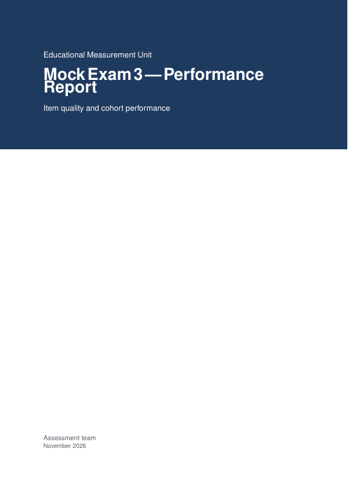
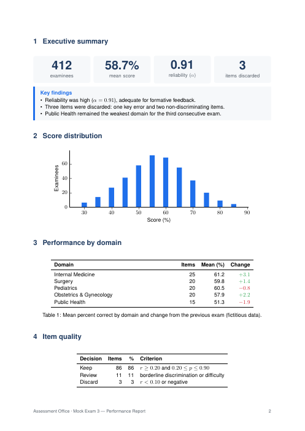
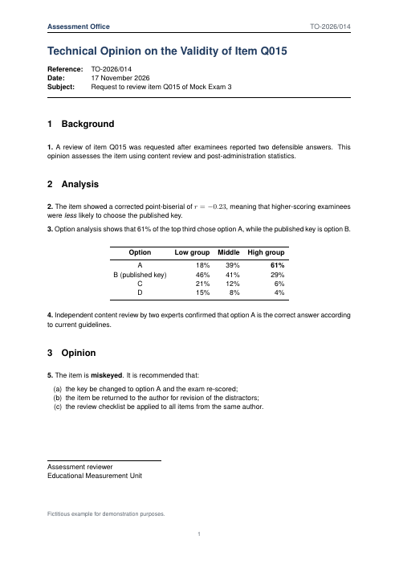
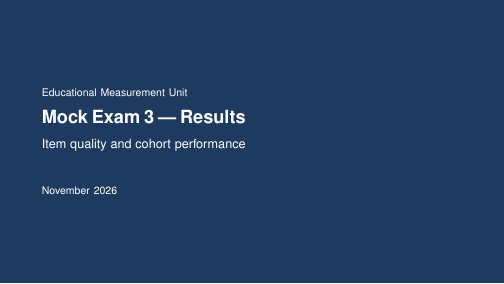
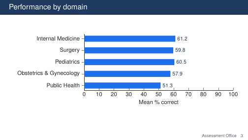

# LaTeX Report Templates


> Clean, configurable LaTeX templates for **technical reports, technical
> opinions and Beamer presentations** in educational assessment — rebranded by
> editing a single file.

<p align="center">
  
  
  
</p>
<p align="center">
  
  
</p>

## 📄 Templates

| Template | Use it for | Highlights | Example |
|---|---|---|---|
| [`report/report.tex`](report/report.tex) | Exam performance reports, annual reports | Full-bleed cover, KPI cards, *key findings* and *recommendation* boxes, pgfplots charts, booktabs tables | [PDF](docs/report.pdf) |
| [`opinion/opinion.tex`](opinion/opinion.tex) | Technical opinions, item appeals, formal notes | Reference block, numbered paragraphs, signature line | [PDF](docs/opinion.pdf) |
| [`beamer/slides.tex`](beamer/slides.tex) | Presenting results to faculty and committees | 16:9, title page and frame titles built from the identity colours, KPI slide | [PDF](docs/slides.pdf) |

## 🎨 One file for the visual identity

Everything brand-related lives in [`identity.sty`](identity.sty):

```latex
\newcommand{\orgname}{Assessment Office}
\newcommand{\orgunit}{Educational Measurement Unit}
\newcommand{\orglogo}{}   % \includegraphics[height=1.1cm]{logo.pdf}

\definecolor{primary}{HTML}{1F3A5F}
\definecolor{secondary}{HTML}{1F6FEB}
\definecolor{accent}{HTML}{D29922}
```

Change the organisation name, colours or logo there and every template follows.

## 🚀 Usage

```bash
git clone https://github.com/alencarpeixotofilho-cloud/latex-report-templates.git
cd latex-report-templates/report && latexmk -pdf report.tex
cd ../opinion && latexmk -pdf opinion.tex
cd ../beamer  && latexmk -pdf slides.tex
```

Requirements: a TeX distribution (TeX Live, MiKTeX) with `tcolorbox`, `pgfplots`,
`booktabs`, `titlesec`, `fancyhdr` and `enumitem` — all included in standard installs.

### Reusable building blocks (report)

```latex
\kpi{0.91}{reliability ($\alpha$)}          % KPI card

\begin{keyfinding}[Key findings]            % highlighted finding box
  ...
\end{keyfinding}

\begin{recommendation}                       % green recommendation box
  ...
\end{recommendation}
```

## 🔗 Works well with

* [`item-analysis-psychometrics`](https://github.com/alencarpeixotofilho-cloud/item-analysis-psychometrics) — produces the item statistics reported here.
* [`test-blueprint-builder`](https://github.com/alencarpeixotofilho-cloud/test-blueprint-builder) — exports blueprints as LaTeX tables.

## 🔒 Data & privacy

All numbers, names and findings in the templates and example PDFs are
**fictitious**. The default organisation name is a placeholder.

## 📄 License

Released under the MIT License. See [`LICENSE`](LICENSE).
